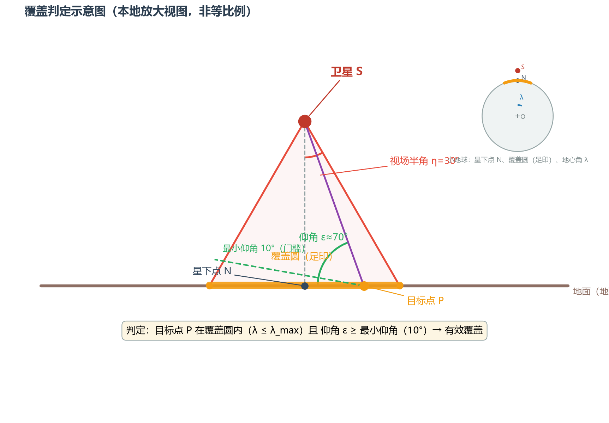

# 卫星覆盖性分析——物理计算方案进展摘要

> 日期：2026-08-04 ｜ 用途：向老师汇报当前进展、确认覆盖口径与下一步优先级

## 一、项目与方案（一句话）

**输入**（地区 + 星座轨道数据 TLE + 时间段）→ **输出**（可用卫星 + 覆盖时间窗口）。

已放弃 ATK 仿真方案（人工操作多、依赖本地软件、无法承载几千颗星），
改用**纯 Python 物理计算**：SGP4 轨道外推 + 几何覆盖判定，无商业软件依赖，普通电脑即可运行。

## 二、当前进展（已完成）

1. **主程序 MVP 跑通**：浙江 + 164 颗遥感星 + 1 天 → 覆盖窗口明细 / 卫星汇总（含覆盖率）/ 整体状态表 / 空窗表 / 文字摘要 / 可用卫星数曲线 / 甘特图；
2. **查询工具**：可按任意子时段查询"某段时间有哪几颗星"，可导出 Excel（多 sheet，给非程序员看）；
3. **验证结论（关键）**：三条互相独立的路径对照（主程序 / 独立算法 / 专业过境预报网站 N2YO）——
   5 颗星、4 种轨道类型，**133 次过境全部对上**，起止时刻偏差 ≤30 秒（多数 3~11 秒）；
   时间粒度"1 分钟粗筛 + 边界 10 秒精化"与全天 10 秒细网格 0 偏差；
4. 代码、结果、文档全程 git 记录（含合并节点），可复现。

## 三、需要确认的覆盖口径（最关键）

覆盖判定 = 目标点**同时满足**两个条件（示意图见文末）：

| 参数 | 当前默认值 | 性质 |
| --- | --- | --- |
| 视场半角 | 30° | 卫星真实传感器指标（**占位默认值**，待真实型号参数） |
| 最小仰角 | 10° | 任务质量门槛（大气路径、图像质量、遮挡） |
| 覆盖判据 | 至少 1 个网格点被覆盖（网格间距 0.2°≈22 km） | 业务口径 |

**请老师/甲方确认**：① 这套口径是否符合需求？② 能否提供目标卫星的真实传感器视场/仰角指标？

## 四、需要拍板的问题

1. **覆盖口径**（上表，最重要）；
2. **交付范围**：物理计算版本是否即当前目标？神经网络是后备方案还是必须参与？
3. **星座与数据**：甲方关心的星座具体是哪些？"几千颗星"指哪些（如 Starlink / OneWeb / 高分系列）？
4. **优先级与时间线**：约两个月交付，输入层（任意地区/时间）→ 大星座扩展 →（可选）神经网络，哪项优先？

## 五、下一步计划

1. 输入层：任意地区（GeoJSON / 点+半径 / 经纬度框）+ 任意时间参数化；
2. TLE 自动更新（每天从 CelesTrak 拉新）；
3. 大星座扩展（几千颗星：数据管理 + 性能 + 按轨道类型抽验）；
4. 事后回算验证（用新 TLE 回算历史窗口，验证预测稳定性）。

---

## 附图

**可用卫星数曲线**（浙江，2026-08-03 全天，纵轴=同时覆盖的卫星数）：

**覆盖判定示意图**（视场角 → 覆盖圆，仰角 → 质量门槛）：

详细验证过程见 [验证报告](验证报告.md)，概念问答见 [答疑记录](答疑记录.md)。
