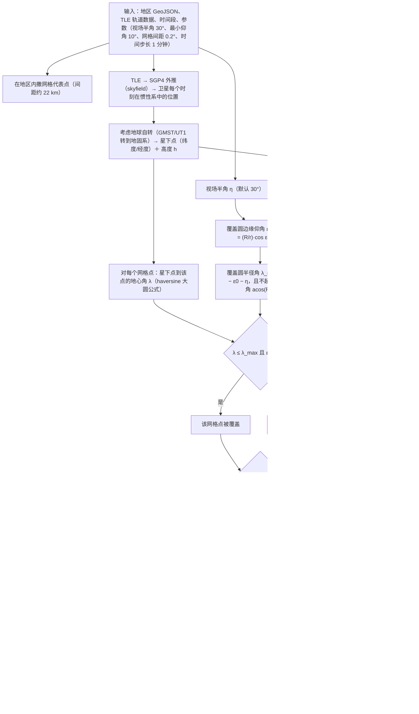

# 覆盖计算流程（完整版）

> 从"输入"到"输出"的完整计算链路，配合 `src/coverage_analysis.py` 阅读。

## 流程图

## 三个关键概念在流程中的位置

1. **覆盖圆（足印）**：由 `视场半角 η` 和 `高度 h` 决定（图中 LMAX1/LMAX2 两格）。
   高度越高圆越大；视场角越大圆越大。公式几何推导见 `coverage_analysis.py` 中
   `footprint_max_angle_deg` 的注释。
2. **仰角 ε**：每个网格点看卫星的仰角，由 `地心角 λ` 和 `高度 h` 算出（ELE 一格）。
   `ε ≥ 最小仰角（10°）` 是任务质量门槛；对高轨/大视场，它会把覆盖圆边缘再削掉一圈。
3. **地球自转**：在"星下点"一步处理（ROT 一格）——SGP4 给出的是惯性系位置，
   skyfield 用地球自转（GMST/UT1）转到地固系，网格点随地球转动，所以算出的
   经纬度是"站在地球上看到"的。
