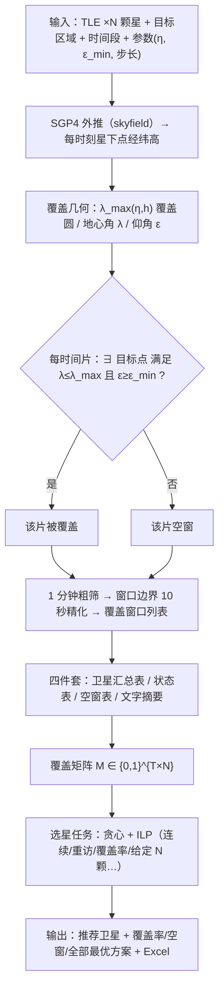

# 卫星覆盖性分析工程 —— 理论与验证报告

> 版本：v1.0　日期：2026-08-10　适用代码：`src/coverage_analysis.py`、`src/satellite_selection.py`（含 GUI 工作台）
> 读者对象：工程背景、非轨道力学专业的读者（含导师汇报场景）。本文给出完整计算链路的数学原理、与关键代码的对应关系、实测精度证据与已知边界，公式到"能复算、能复现"为止，不深入天体力学与优化理论的证明细节。

---

## 摘要

本工程解决的问题是：**给定一组卫星的轨道数据（TLE）、一个目标区域（点+半径 或 多边形）、一个时间段，回答"哪个时刻、哪几颗卫星能覆盖目标，以及要选出哪几颗组成虚拟星座"。**

完整计算链分为五段：

1. **轨道外推**：TLE 两行根数 → SGP4 传播 → 每个时刻卫星在地固系中的经纬高（星下点）；
2. **覆盖几何**：由轨道高度与传感器视场半角算覆盖圆（足印），由星下点与目标点算地心角与仰角，两者联合判定"该时刻是否覆盖"；
3. **时间推进**：把时间段切成 1 分钟时间片逐片判定，再对窗口边界做 10 秒精化，得到每颗星的覆盖窗口（开始/结束/时长）；
4. **表格整理**：由窗口汇总出"卫星汇总表 / 状态表 / 空窗表 / 文字摘要"，并投影成"时间片 × 卫星"覆盖矩阵；
5. **选星优化**：在覆盖矩阵上按需求（连续覆盖、重访 MRT、给定 N 颗等五种任务）用贪心与整数规划（ILP）选出满足需求的卫星组合，输出推荐清单、覆盖率、空窗与全部最优方案。

可信性证据（详见第 5、6 章）：

- 与专业过境预报网站 N2YO 交叉对照，低轨遥感星过境起止时刻偏差 ≤ 10~20 秒（133 次过境全部对上）；
- 两条完全独立的代码路径（skyfield 主路径 vs 底层 sgp4 + 手写几何）逐分钟判定 1441/1441 一致；
- 时间步长敏感性：1 分钟+10 秒精化 与全程 10 秒细算的总覆盖时长偏差仅 0.11%；
- 选星贪心与整数规划两套算法在 303 颗 × 8 小时实测中结果完全一致，ILP 求解 < 1 秒。

已知边界（如实声明，均为文档化口径而非 bug）：当前传感器模型为"固定视线圆锥 + 最小仰角"（视场半角=视线张角，默认 10° 为假设值），未含侧摆/敏捷指向与条带级成像模型；对低轨窄视场星偏保守。这一口径的取舍依据见第 7 章。

---

## 数据流总览



---

## 符号表

| 符号 | 含义 | 单位 |
| --- | --- | --- |
| R | 地球半径（球近似，R = 6378.137） | km |
| h | 卫星轨道高度（星下点处） | km |
| r | 卫星地心距，r = R + h | km |
| η | 视场半角（视线张角、天底圆锥半角，默认 10°，假设值） | ° |
| ε | 目标点处观测卫星的仰角（擦地角） | ° |
| ε_min | 最小仰角门槛（默认 10°，经典标准值） | ° |
| λ | 星下点与目标点之间的地心角（大圆角） | ° |
| λ_max | 覆盖圆（足印）最大地心角，随 h、η 变化 | ° |
| W | 传感器幅宽（逐星可选口径） | km |
| T | 时间片总数（默认 1 分钟一片） | 片 |
| N | 卫星总数 | 颗 |
| K | 需求：每个达标时间片内最少同时覆盖数 | 颗 |
| MRT | 需求：允许的最大重访间隔（最长空窗） | min |
| ART | 实际平均空窗（Average Revisit Time） | min |
| x_j | 决策变量：是否选择第 j 颗卫星（0/1） | — |
| y_i | 辅助变量：第 i 个时间片是否"达标"（覆盖数 ≥ K，0/1） | — |
| n̄ | TLE 平运动（mean motion，no_kozai） | rad/min |
| P | 轨道周期，P = 2π/n̄ | min |

---

# 第 1 章　从 TLE 到卫星位置：SGP4 轨道外推

## 1.1 TLE：两行轨道根数是什么

TLE（Two-Line Element）是美国太空军公开编目的**标准轨道描述格式**，每颗卫星由三行文本组成：名称行 + 两行数字。核心信息是**历元时刻（epoch）**下的六个轨道根数（开普勒根数）：

| 根数 | 含义 | TLE 位置 |
| --- | --- | --- |
| i | 轨道倾角（对赤道面） | 第二行第 9~16 列 |
| Ω | 升交点赤经（RAAN） | 第二行第 18~25 列 |
| e | 偏心率（0=正圆） | 第二行第 27~33 列 |
| ω | 近地点幅角 | 第二行第 35~42 列 |
| M₀ | 历元平近点角 | 第二行第 44~51 列 |
| n̄ | 平运动（每天圈数） | 第二行第 53~63 列 |

另有第一行的 NORAD 编号、历元（YYYYDDD.ffffffff）、平运动一阶/二阶导数（用于大气阻力等长期摄动的粗略描述）等。

关键认知：**TLE 只是"某一时刻的轨道状态"，不能直接拿来当位置用**。要得到任意时刻卫星的位置，必须经过传播器外推。对应代码（`satellite_loader.py` 的 TLE 解析与包装）：

```python
from skyfield.api import EarthSatellite
sat = EarthSatellite(line1, line2, name, ts)   # 解析 TLE 三行
```

## 1.2 SGP4：标准传播算法

SGP4（Simplified General Perturbations model 4）是北美防空司令部（NORAD）专门为 TLE 口径配套的解析传播算法，其地位由两篇文献确立：

- **Hoots & Roehrich, "Spacetrack Report No.3: Models for Propagation of NORAD Element Sets" (1980)**——SGP4 算法原始出处；
- **Vallado, Crawford, Hujsak & Kelso, "Revisiting Spacetrack Report #3", AIAA 2006-6753 (2006)**——把 SGP4/SDP4 实现公开化、规范化，今天的 `sgp4` 库即其现代实现。

SGP4 做的事可概括为：**输入 = 历元根数 + 目标时刻 t；输出 = t 时刻卫星在 TEME 惯性坐标系中的位置矢量 r(t)（km）与速度矢量 v(t)（km/s）**。

它的物理内容是二体问题解析解（开普勒轨道）+ 摄动修正：

1. **二体项**：由平近点角 M₀ 和偏心率 e 解开普勒方程 M = E − e·sinE，得到真近点角，从而得到纯椭圆轨道上的位置（这正是"开普勒轨道、卫星以椭圆绕地球"的数学形式）；
2. **J2 摄动项**：地球并非正球，赤道隆起（J2 项）使轨道面与拱线缓慢旋转——表现为升交点赤经 Ω 和近地点幅角 ω 的长期漂移。低轨遥感星常见的"太阳同步轨道"正是利用 J2 让轨道面每天东进约 0.9856°，使过境地方时基本固定；
3. **大气阻力与太阳光压的简化模型**：体现在 TLE 的平运动导数上，由 SGP4 以短周期/长周期项形式修正。

工程上**不需要复现 SGP4 内部公式**（这正是库存在的意义），但要理解三点：

- SGP4 精度与 TLE 时效强相关：TLE 发布时刻附近误差为公里量级，越旧误差越大（典型 1~3 km/天量级，见第 5 章）；
- TLE 的"口径"就是 SGP4，两者必须配对使用（用别的高精度传播器推 TLE 反而对不上公开预报）；
- SGP4 输出是**惯性系**位置，要得到地面上看到的经纬度，还需考虑地球自转转到地固系。

## 1.3 从惯性系位置到星下点：地球自转与地固系

对应代码（`coverage_analysis.py` 的 `compute_covered_series`）：

```python
geocentric = sat.at(t)                    # SGP4 外推：TEME 惯性系位置/速度
sub = geocentric.subpoint()               # skyfield 完成坐标系转换（含地球自转）
lat = sub.latitude.degrees                # 星下点纬度
lon = sub.longitude.degrees               # 星下点经度
alt = sub.elevation.km                    # 轨道高度 h
```

`sat.at(t)` 内部即调用 `sgp4` 库（TEME 系），`subpoint()` 由 skyfield 用地球自转角（GMST/UT1 模型）旋转到地固系（ITRS），再按椭球（WGS84）投影出经纬高。因此我们拿到的 `(lat, lon, alt)` 是"站在地球上抬头看卫星在天上哪个方向"所需的全部几何量，目标点也随地球一起转，天然正确。

## 1.4 轨道类型判定：orbit_tag

覆盖分析需要区分轨道类型（低轨 / 高轨 / GEO 静止），用于幅宽回退等业务逻辑（见 2.4 节）。由 TLE 平运动直接反推周期（`coverage_analysis.py` 的 `orbit_tag`）：

```python
no_kozai = float(sat.model.no_kozai)      # 平运动，rad/min
period_min = 2 * np.pi / no_kozai
```

| 周期 P | 判定 | 典型例子 |
| --- | --- | --- |
| P ≥ 1300 min | GEO / 静止 | GAOFEN-4（约 1436 min）、YAOGAN-41 |
| 700 ≤ P < 1300 min | 高轨 | 部分导航/中高轨星 |
| P < 700 min | 低轨 | 吉林一号、YAOGAN-7（约 97 min） |

注：TLE 平运动给出的是"平均角速度"，由它算出的周期已含 J2 的一阶效应，足够用于这种秒级判定的用途（与轨道高度 h 的对应关系 h ≈ (μ·P²/4π²)^(1/3) − R，其中 μ = 398600.4418 km³/s² 为地球引力常数）。

---

# 第 2 章　覆盖几何：什么算"一颗卫星覆盖一个目标点"

本章解决核心判据：**给定卫星在 t 时刻的星下点 (lat, lon) 与高度 h，目标点 P 是否被覆盖？** 答案是两个几何条件**同时**成立：

（a）目标点落在传感器视场圆锥与地面的交线——"覆盖圆（足印）"内，即星下点与目标点的地心角 λ ≤ λ_max；
（b）目标点处观测卫星的仰角 ε ≥ 最小仰角 ε_min（默认 10°）。

条件 (b) 是业务门槛而非纯几何条件：仰角太低意味着视线贴近地平线、大气路径长、遮挡与质量风险高，业界覆盖分析普遍不把它算作有效观测（N2YO 的"过境"口径即仰角 ≥ 0°，我们更严）。

## 2.1 覆盖圆（足印）半径：λ_max 的推导

把传感器视场看成以天底（星下点方向）为轴、半角 η 的圆锥。圆锥与地面的交线近似为圆（对中低轨完全成立；对 GEO 大视场，交线偏大但同一公式加上 (3) 式的地平线截断，给出覆盖地心角的正确上界）。

考虑地心 O、卫星 S、覆盖圆边缘点 P 构成的平面三角形（球面近似下取过这三点的截面，即一大圆截面）：

```
        S（卫星，地心距 r = R + h）
       /|  η 为 S 处的内角（视场半角）
      /  |
     /    |
  r /      \ r
   /        \
  / ε + 90°  \          （P 处的内角 = 90° + ε，ε 为仰角）
 O ----------- P
       R
     λ（地心角，O 处内角）
```

三角形内角和给出第一个关系：

　　λ + (90° + ε) + η = 180°　　⇒　　λ = 90° − ε − η　　　　(1)

对边与正弦定理给出第二个关系（P 处对边 OS = r，S 处对边 OP = R）：

　　sinη / R = sin(90° + ε) / r = cosε / r　　⇒　　sinη = (R / r) · cosε　　　　(2)

**覆盖圆边缘**意味着同时满足 (1)(2)。解法定序：

1. 由 (2) 解边缘仰角：ε₀ = arccos( (r/R)·sinη )，当 (r/R)·sinη ≥ 1 时边缘仰角取 0（视场大到触及地平线）；
2. 代入 (1) 得 λ_max = 90° − ε₀ − η；
3. 覆盖圆不可能超过地平线（看不到地球背面），因此 λ_max 再与地平线地心角 λ_horizon = arccos(R/r) 取小者截断：

　　λ_max = min( 90° − ε₀ − η, arccos(R/r) )　　　　(3)

这正是 `coverage_analysis.py` 中 `footprint_max_angle_deg` 的实现（含 `horizon = arccos(R/r)` 与 `np.minimum` 截断）。

**直观检验**：η 越大、h 越高，覆盖圆越大。当 η = 0（垂直窄条带）时 λ_max → 0；当卫星在低轨、η 很小（如 1°~2°，普通成像星的窄视场）时，足印半径约 h·tanη（平面近似），与"几百公里高、几十公里宽条带"的直觉一致。

### 数值示例（由工程函数实测）

| h (km) | η = 5° | η = 10° | η = 20° | η = 30° |
| --- | --- | --- | --- | --- |
| 500 | 0.39°（44 km） | 0.79°（88 km） | 1.64°（183 km） | 2.63°（292 km） |
| 630 | 0.50°（55 km） | 1.00°（111 km） | 2.07°（231 km） | 3.33°（370 km） |
| 700 | 0.55°（61 km） | 1.11°（124 km） | 2.31°（256 km） | 3.70°（412 km） |
| 780 | 0.61°（68 km） | 1.24°（138 km） | 2.57°（286 km） | 4.14°（460 km） |
| 1000 | 0.79°（87 km） | 1.59°（177 km） | 3.31°（368 km） | 5.34°（594 km） |
| 35786（GEO） | 30.2°（3356 km） | 80.0°（8895 km，地平线截断） | 70.0°（7783 km，地平线截断） | 60.0°（6671 km，地平线截断） |

注：半径按 1° 地心角 ≈ 111.19 km（赤道弧长）换算，GEO 行是"地平线截断后的可见半球"量级。表中可见：低轨窄视场（η=10°）的足印半径仅约 111~124 km，这正是"低轨星对一个点的覆盖窗口只有几十秒到几分钟"的几何根源（见第 3 章窗口结果）。

## 2.2 目标点与星下点的地心角：大圆距离

两个经纬点 (lat₁, lon₁)、(lat₂, lon₂) 之间的地心角用 haversine 公式（球面大圆距离）计算（`central_angle_deg`）：

　　a = sin²(Δφ/2) + cosφ₁·cosφ₂·sin²(Δλ/2)　　　　(4)

　　λ = 2·atan2( √a, √(1−a) )　　　　(5)

其中 Δφ = φ₂ − φ₁、Δλ = λ₂ − λ₁ 为经纬差。对 5 km 级目标圆，球面近似带来的误差在米~百米级，可忽略（见第 5 章）。

## 2.3 目标点仰角：擦地角公式

由同一三角形的正弦/余弦定理可得目标点 P 处看卫星的仰角（`elevation_at_deg`）：

　　tanε = (cosλ − R/r) / sinλ　　　　(6)

代码实现为 `arctan2(cosλ − R/r, sinλ)`（自动处理 λ=0 时 90° 的极限）。

物理检验：

- λ = 0（卫星在正头顶）：ε = 90°；
- λ = arccos(R/r)（目标点在地平线上）：ε = 0；
- 对 GEO（r/R ≈ 6.61）：杭州与静止星（星下点约 0°N, 105°E）的地心角 λ ≈ 33.5°，由 (6) 得 ε ≈ 51°，与实际验证中 GAOFEN-4 对杭州仰角 51°~58° 完全吻合——这就是"一颗 GEO 星能全天覆盖东半球目标"的几何证明。

## 2.4 幅宽换算：逐星可选口径

当传感器资料给出的是幅宽 W（km）而非角度时，按该星**当前时刻轨道高度**换算成等效视场半角（`swath_to_half_angle_deg`），再走同一套圆锥几何（Q142/Q143 拍板口径）：

　　λ_W = (W/2) / R　　　　(7)（半幅宽对应的地心角，弧长/半径）

　　η = atan( R·sinλ_W / (r − R·cosλ_W) )　　　　(8)

典型换算（h = 700 km，由工程函数实测）：Landsat 185 km → 7.52°；Sentinel-1 IW 250 km → 10.11°；SPOT 60 km → 2.45°；WorldView-3 13.1 km → 0.54°。这与文献中"由幅宽反推相机半视场角"的常见公式一致（Q145 调研结论）。

业务规则（Q152 拍板）：幅宽只对**低轨**星逐星生效；GEO/高轨凝视成像星没有"条带"概念，填了幅宽也自动回退到视场半角，并在输出中警告。判定依据即 1.4 节的 `orbit_tag`。

## 2.5 两种目标模式的判定式

**模式一：点 + 半径（目标圆，老师拍板的主模式，默认 5 km）**（`compute_covered_series` 的 circle 分支）：

　　covered(t) = ( λ(t) ≤ λ_max(t) + λ_target ) ∧ ( ε(t) ≥ ε_min )　　　　(9)

其中 λ_target = radius_km / R 为目标圆半径对应的地心角——即**足印圆与目标圆有交集**就算覆盖（足印圆心距 ≤ 两圆半径角之和）。同时输出目标圆被足印覆盖的面积比例 `ratio`（平面圆交叠面积公式，`circle_overlap_ratio`），用于"覆盖质量"展示。

**模式二：多边形区域（GeoJSON）**：在区域内按 0.2° 间距（约 22 km）撒网格代表点，任一时刻 `covered = (λ ≤ λ_max) ∧ (ε ≥ ε_min)` 对任一网格点成立即算区域被覆盖，`ratio` = 被覆盖网格点占比。

两种模式的判据形式完全一致，只是"目标点集合"不同。

## 2.6 公式 ↔ 代码对应表（第 2 章）

| 数学量/公式 | 代码位置（`coverage_analysis.py`） | 说明 |
| --- | --- | --- |
| λ_max，(1)(2)(3) | `footprint_max_angle_deg(altitude_km, fov_half_deg)` | 含地平线截断 |
| λ，大圆角 (4)(5) | `central_angle_deg(lat1, lon1, lat2, lon2)` | 向量化 haversine |
| ε，(6) | `elevation_at_deg(lam_deg, altitude_km)` | arctan2 实现 |
| η 换算，(7)(8) | `swath_to_half_angle_deg(altitude_km, swath_km)` | 幅宽→等效半角 |
| 判据 (9) | `compute_covered_series()` 中 `covered_grid = (lam <= lam_max) & (elev >= min_elev)` | 本工程核心判定行 |
| 覆盖比例 | `circle_overlap_ratio(d_km, r_foot_km, r_target_km)` | 目标圆被覆盖面积占比 |
| GEO/高轨回退 | `orbit_tag(sat)` + `resolve_sat_cfg(norad_id, …)` | 幅宽仅低轨生效 |

---

# 第 3 章　时间推进：从"逐时刻判定"到"覆盖窗口"

## 3.1 时间栅格

输入时间段 [t₀, t₁]（UTC）按固定步长 Δt 切成等间隔时间片（`make_time_array`，默认 Δt = 1 分钟）：

　　t_i = t₀ + i·Δt，i = 0, 1, …, T−1，T = ⌊(t₁−t₀)/Δt⌋ + 1　　　　(10)

对每个时间片 t_i，SGP4 外推一次。低轨星沿轨地速约 6.8 km/s、星下点 1 分钟移动约 400 km，远大于足印半径（约 110 km），所以 1 分钟粗筛只能定位窗口的"大数位置"，秒级边界要交给第二段精化；同时每颗星独立计算，天然可并行/向量化。总计算量为 **N 颗星 × T 个时间片 × M 个目标点** 的几何判定，是全程唯一的重计算：

- 268 颗遥感星 × 1 天（1441 片）× 5 km 目标圆：约 1.9 s；
- 10766 颗星链 × 1 天：约 27.6 s（实测，2026-08-06）；
- 303 颗遥感全量 × 8 h（481 片）：单机秒级，选星 ILP < 1 s。

## 3.2 两段式窗口提取（粗筛 + 边界精化）

如果全程用 10 秒步长细算，计算量是 1 分钟步长的 6 倍，而绝大多数时间片（远在窗口之外）白白算了。工程解法是**两段式**（`analyze_one_satellite`）：

**第一段（粗筛）**：1 分钟步长逐片判定 covered(t_i) ∈ {0,1}，把连续为 1 的片段合并为粗窗口 [s, e]。

**第二段（精化）**：对每个粗窗口，向两侧各扩 margin（默认 3 分钟），在扩出的子区间内用 10 秒细网格重算（`refine_step_seconds=10`），取细网格上被覆盖的首末时刻为精化边界；随后合并重叠的精化窗口、裁回分析时段、过滤零时长伪窗口。

这样"已检出窗口的边界精度 = 10 秒"，而计算量 ≈ 1 分钟粗筛（精化只算窗口附近）。验证证明：**精化后的窗口与全程 10 秒细算逐窗口边界偏差为 0 秒**（5 颗星、4 种轨道类型回归，2026-08-04）。

边界说明（严谨起见）：精化只能修正"已检出"窗口的边界；若某个窗口短于 1 分钟且恰好完全落在两个粗采样点之间，理论上可能整体漏检。实测中（303 颗 × 8 h 总时长偏差 0.11%、5 颗星全天逐窗口对比）未观测到此类漏窗，但对秒级事件密集的任务，应调小粗筛步长（计算量线性增加）。

## 3.3 窗口数据模型

每颗星输出窗口列表，元组为 (卫星名, 开始时刻, 结束时刻, 窗口内最大覆盖比例)：

　　w = (name, s, e, r_max)，时长 = e − s　　　　(11)

窗口时长按精化后的起止差计算（`window_duration_s`；无精化时按粗筛步长补一个 Δt）。物理规律（实测）：低轨遥感星对单个点的覆盖窗口约几十秒~几分钟（足印"扫过即走"）；GEO 星对东半球目标可覆盖整个分析时段（单窗口 = 全时段）。

## 3.4 四件套输出：结果怎么整理

全部窗口汇总后生成四张表（`summarize_windows` / `build_state_table` / `build_gaps_table` / `build_summary_text`），并导出 CSV / Excel / 甘特图（可选）：

**① 卫星汇总表（按星）**：每颗星一行——窗口数、总覆盖时长、覆盖率、最长窗口、最大空窗、首次/末次覆盖时刻。

　　coverage_pct = (总覆盖时长 / 分析时段总时长) × 100%　　　　(12)

**② 状态表（按时间）**：把窗口投影回 1 分钟网格，只在"覆盖卫星集合发生变化"的时刻记一行（状态段），列为开始/结束/覆盖星数/卫星名单/时长。这是"每个时刻有哪些星可用"的矩阵化表达，也是选星覆盖矩阵的直接来源。

**③ 空窗表**：状态表中"覆盖星数 = 0"的段，按时长降序排列——空窗 = 任何卫星都不覆盖目标的时间段。

**④ 文字摘要**：自动生成的人话总结（覆盖星数、最长空窗、GEO 星列表等）。

覆盖窗口是全程的"铁律输出"（AGENTS.md 2.1）：任何"某时刻能否覆盖"的布尔简化都不能替代窗口序列，因为选星五个任务全部建立在这些窗口之上。

## 3.5 覆盖矩阵：把窗口投影成决策问题的输入

选星前先把窗口投影为 0/1 矩阵（`build_slice_cover`）：对时间片网格 t_i（与覆盖分析同一步长），卫星 j 在时间片 i 的取值

　　M[i, j] = 1 ⇔ 时间片 i 落在卫星 j 的某个窗口 [s, e] 内　　　　(13)

即"第 j 颗星覆盖第 i 个时间片"。矩阵规模 T × N（303 颗 × 481 片 ≈ 14.6 万元素，布尔数组内存 < 1 MB；1 万颗 × 1441 片 ≈ 1440 万元素 ≈ 14 MB，仍完全可承受）。这是第 4 章所有选星算法的唯一输入。

## 3.6 公式 ↔ 代码对应表（第 3 章）

| 步骤 | 代码位置 | 说明 |
| --- | --- | --- |
| 时间栅格 (10) | `make_time_array(ts, start, end, step_minutes)` | datetime + skyfield 时间对象 |
| 粗筛+精化 | `analyze_one_satellite(sat, t, dt_list, region, cfg)` | 1 分钟粗筛 → 10 秒边界精化 → 合并/裁剪/过滤 |
| 窗口时长 (11) | `window_duration_s(start, end, cfg)` | 精化后起止差 |
| 汇总表 (12) | `summarize_windows(all_windows, cfg, period_seconds)` | 每星一行统计 |
| 状态表 | `build_state_table(all_windows, t0, t1, cfg)` | 时间片视图，只在状态变化时记行 |
| 空窗表 | `build_gaps_table(state_df)` | n_satellites == 0 的段 |
| 覆盖矩阵 (13) | `satellite_selection.build_slice_cover(sats, windows_by_sat, dt_list)` | 窗口 → T×N 布尔矩阵 |

---

# 第 4 章　选星：从覆盖矩阵到虚拟星座

## 4.1 给定一组卫星，如何评估"组合覆盖"

设选中集合 S（下标集合），每个时间片 i 的覆盖数（`_counts_of`）：

　　c_i = Σ_{j∈S} M[i, j]　　　　(14)

**达标判定**（需求 K）：covered_i = 1 ⇔ c_i ≥ K。派生指标（`evaluate_selection`）：

　　coverage_pct = (Σ_i covered_i / T) × 100%　　　　(15)（覆盖率 = 达标时间片占比）

　　MRT_actual = max{ 连续不达标片的时长 }　　　　(16)（最长空窗，即最大重访间隔）

　　ART_actual = mean{ 各段不达标片的时长 }　　　　(17)（平均空窗）

空窗段定义为连续不达标的时间片序列（含时段首尾），时长 = 段长 × 步长。**注意口径**：覆盖率与"需求是否满足"是两件事——覆盖率看"时间占比"，MRT 看"最长一段多长"；连续覆盖需求（覆盖率 100% 且无空窗）是两者同时成立的特例。

**全池基线（物理上限）**：选星前先评估"所有导入星一起上"能达到的覆盖率与最长空窗（`run_selection` 中的 `full` 与 `feasibility`）。若连续覆盖在物理上不可行（低轨星座轨道族天然有空窗），如实报告"即使全部卫星一起上，最长空窗仍达 X 分钟、覆盖率仅 Y%"，并给出出路（加 GEO/高轨星、缩小区域、缩短时段、改重访模式）——**不硬凑一个声称满足的虚假方案**（Q99/Q119 拍板）。

## 4.2 五种任务（需求语义）

| 任务 | 需求语义 | 目标 | 算法 |
| --- | --- | --- | --- |
| ① 连续覆盖·最少颗数（可推广为覆盖率 ≥ P%·最少颗数，PSCLP） | 每个时间片都 ≥ K 颗（或达标片占比 ≥ P%） | 卫星数最少 | 贪心 + ILP（精确） |
| ② 重访·最少颗数 | 任意空窗 ≤ MRT 分钟（每 X 分钟至少 1 次） | 卫星数最少 | 贪心 + ILP（精确） |
| ③ 给定 N 颗·覆盖率最大 | 预算 N 颗 | Σcovered_i 最大 | 贪心 + ILP（精确） |
| ④ 给定 N 颗·最长空窗最小（MMRT） | 预算 N 颗 | max 空窗最短 | 贪心 + ILP（二分+可行性，精确） |
| ⑤ 给定 N 颗·平均空窗最小（MART） | 预算 N 颗 | 平均空窗最短 | 贪心（平均空窗为分式目标，无精确 ILP，文档化说明） |

任务①②是"最少颗数"型（集合覆盖族），③④⑤是"给定预算 N"型（最大覆盖/瓶颈优化族）。K 参数只在任务①有意义（其余任务固定 K=1 或按界面语义）。

## 4.3 任务①②的整数规划（ILP）建模

选星本质是 0/1 整数规划。以任务②（重访）为例，变量与约束如下（`ilp_select`）：

**变量**：x_j ∈ {0,1}（是否选卫星 j）；y_i ∈ {0,1}（时间片 i 是否达标）。

**目标**：

　　min Σ_j x_j　　　　(18)

**约束 1（达标 ⇒ 覆盖数 ≥ K）**：

　　Σ_j M[i,j]·x_j ≥ K·y_i，∀i　　　　(19)

**约束 2（覆盖数 ≥ K ⇒ 强制达标，M = N 为大数）**：

　　Σ_j M[i,j]·x_j − M·y_i ≤ K−1，∀i　　　　(20)

约束 1、2 联合保证 y_i = 1 ⇔ c_i ≥ K（线性化"达标"指示变量）。

**约束 3（重访：任意连续 W = ⌊MRT/Δt⌋ + 1 个时间片至少 1 片达标）**：

　　Σ_{k=0}^{W−1} y_{t+k} ≥ 1，∀t = 0, …, T−W　　　　(21)

这等价于"不达标连续段长度 ≤ ⌊MRT/Δt⌋ 片"，即空窗 ≤ MRT。当 MRT = 0（连续覆盖）时 W = 1，约束退化为 y_i = 1 ∀i，正是任务①。

代码用 `pulp`（CBC 求解器）实现，逐条生成 (19)(20)(21)，与上式一一对应。

## 4.4 PSCLP：覆盖率 ≥ P% 的最少颗数

任务①的推广（`ilp_select_coverage`）：把约束 3 换成一条总数约束——

　　Σ_i y_i ≥ ⌈P%·T⌉　　　　(22)

目标仍是 min Σx_j。这就是文献中的 **PSCLP（Partial Set Covering Location Problem）**：用最少的集合（卫星）覆盖至少 P% 的元素（时间片）。P = 100% 时 (22) 强制全部达标，等价于连续覆盖。

## 4.5 任务③：给定 N 颗最大化覆盖率

（`ilp_select_max_coverage`）目标变为 max Σ_i y_i，新增预算约束：

　　Σ_j x_j ≤ N　　　　(23)

约束 (19)(20) 不变。这是经典 **最大覆盖问题（Maximum Coverage）** 的 0/1 规划形式。

## 4.6 任务④：给定 N 颗最小化最长空窗（MMRT）

思路是**对空窗上限二分 + 可行性 ILP**（`ilp_select_min_max_gap`）：

1. 空窗上限 T 在 [0, T·Δt] 区间二分；
2. 每次调用任务②的可行性版本 `ilp_select(…, mrt=T, n_limit=N)`，判断"在预算 N 内是否存在空窗 ≤ T 的方案"；
3. 找到的最小可行 T* 即最小可达最长空窗，其方案即最优。

由于 T* 单调（预算内可行集合随 T 增大而单调），二分只需约 log₂T 次 ILP 调用，工程可行（CBC 每次秒级）。

## 4.7 任务⑤：平均空窗（MART）为什么只有贪心

"最小化平均空窗"的目标 Σ(空窗时长) 是**分段分式函数**（段数、段长都随选择变化），线性化需要大量辅助变量且数值不稳，业界同样少用精确 ILP。因此任务⑤明确标注"贪心近似"（`select_min_gap` 的 mode="avg"）：每轮从能覆盖当前空窗的候选星里，挑使"下一轮平均空窗最短"的一颗。

## 4.8 贪心算法：直觉、策略与近似比

贪心的共同直觉是**"每步吃眼前最大的收益"**。四个贪心变体的策略：

| 变体 | 对应任务 | 每步收益定义 | 后处理 |
| --- | --- | --- | --- |
| `greedy_select` | ①② | 覆盖"当前超长空窗"（长度 > MRT）时间片最多的未选星 | "能删就删"局部改进 |
| `greedy_select_coverage` | ①(P%) | 使达标片数增加最多的星（K≥2 时按"向 K 靠近的有效增量"计） | 达到阈值即停 |
| `select_max_coverage` | ③ | 同上，但预算封顶 N 颗 | 选满或无法再增；满额前补足 |
| `select_min_gap` | ④⑤ | 覆盖当前目标空窗的候选星中，使下一轮最长（或平均）空窗最短的一颗 | 选满或空窗不再缩短 |

**近似比（为什么贪心"够好"）**：

1. **集合覆盖**（任务①②）：Chvátal (1979) 证明每次选"覆盖最多未覆盖元素"的贪心，其解规模 ≤ 最优解的 (ln k + 1) 倍，其中 k 为最大集合大小（这里即单星最多覆盖的时间片数）。对 1441 片的时间域，ln 1441 ≈ 7.3，即贪心最坏不超过最优的约 8 倍；实测中因遥感星窗口高度重叠，贪心与 ILP 通常一致或仅差 1 颗。
2. **最大覆盖**（任务③）：Nemhauser、Wolsey 与 Fisher (1978) 证明子模函数贪心达到 (1 − 1/e) ≈ 63.2% 的最优值下界，Feige (1998) 证明该界在 P ≠ NP 下不可改进——即贪心是**理论最优的近似算法**（除非 P = NP）。
3. **PSCLP**：Cordeau、Furini 与 Ljubić (2019) 给出大规模 PSCLP 的精确分解算法（Benders 分解），说明该问题业界用精确方法可解到万级规模；我们 ≤ 1500 颗直接上 ILP，规模在精确可解范围内。

工程策略：**默认"两者对照"**——贪心秒出结果，ILP 在限时内给出最优（"最优（已证明）"），两者不一致以 ILP 为准；ILP 不可用/超时/规模超限时自动退回贪心并明示。

## 4.9 复杂度与规模边界

- **贪心**：每轮扫描全部未选星 × 时间片，最坏 O(N²·T)；N=1500、T=481 时约 10⁹ 次布尔与，numpy 向量化后秒级；
- **ILP（CBC）**：变量数 N + T，约束数 2T + (T−W+1) + 预算/总数。CBC 对 N ≤ 1500、T ≤ 2000 的问题典型 < 1 s（303 颗 × 481 片实测），但最坏情况下限时 60~180 s 截断（`timeLimit`），超时给出当前最优可行解并注明；
- **规模阈值**：N > 1500 自动跳过 ILP 退回贪心（"卫星数过多（>1500），整数规划太慢，自动退回贪心"），这是文档化的工程边界；星链 1 万颗级场景用贪心 + 覆盖矩阵（矩阵本身约 14 MB，可承受）。

## 4.10 全部最优方案枚举（no-good cut）

用户/老师常需要"不止一种选择"（如 K=1 时有 4 颗全程星 → 4 种单星方案）。实现（`enumerate_optimal_solutions` / `enumerate_optimal_coverage_solutions`）：

1. **全程星特判**：若存在 ≥ K 颗"全程覆盖"星（M[j,:] 全为 1），全部最优 = 任选 K 颗全程星的组合，直接枚举组合数（K=1：C(4,1)=4；K=2：C(4,2)=6，已验证）；
2. **一般情况**：迭代求解 ILP，每得到一个最优解 S，就加一条 **no-good cut** 排除它：

　　Σ_{j∈S} x_j ≤ |S| − 1　　　　(24)

再求解，直到目标值变差或收集满 max_solutions（默认 10）个；结果注明"可能还有更多"。这样既给了多样性，又保证每个方案都是最优。

## 4.11 公式 ↔ 代码对应表（第 4 章）

| 数学对象 | 代码位置（`satellite_selection.py`） | 说明 |
| --- | --- | --- |
| 覆盖数 (14)、达标、指标 (15)(16)(17) | `evaluate_selection(sat_cov, selected, k_min, mrt_minutes, …)` | 输出覆盖率/MRT/ART/空窗表 |
| 任务①② ILP (18)(19)(20)(21) | `ilp_select(…, time_limit=180)` | pulp + CBC |
| PSCLP (22) | `ilp_select_coverage(…)` | 达标片数 ≥ ⌈P%·T⌉ |
| 任务③ (23) | `ilp_select_max_coverage(…)` | max Σy，预算 Σx ≤ N |
| 任务④（二分） | `ilp_select_min_max_gap(…)` | 二分空窗上限 + 可行性 ILP |
| 贪心①② | `greedy_select(…)` / `greedy_select_coverage(…)` | 缺口最大化 + 能删就删 |
| 贪心③④⑤ | `select_max_coverage(…)` / `select_min_gap(…)` | 边际收益 / 空窗最短 |
| 最优枚举 (24) | `enumerate_optimal_solutions(…)` 等 | 全程星组合 + no-good cut 迭代 |
| 总入口 | `run_selection(sats, windows_by_sat, t0, t1, …)` | req_mode/objective 分派 + 全池基线 + 结果字典 |

---

# 第 5 章　精度与可用性：结果有多可信、够不够用

## 5.1 误差源清单

覆盖窗口的时间误差来自四个叠加的环节：

| 误差源 | 量级 | 说明 |
| --- | --- | --- |
| SGP4 外推 + TLE 时效 | 位置公里级 → 窗口秒级 | TLE 越旧误差越大；用当天 TLE 时窗口偏差典型 < 20 s（N2YO 对表实测） |
| 球面地球近似（R 取 6378.137 km） | 仰角 1° 级、窗口秒级 | 未用 WGS84 椭球；验证中边界判定翻转仅出现在"恰好 10.0°"擦边时刻 |
| 时间步长 Δt = 1 分钟 | 粗筛窗口 ±1 分钟 | 已被 10 秒边界精化消除到 ≤ 10 s（精化一致性 0 s） |
| 网格采样（多边形模式 0.2°） | 覆盖率 ±1 个网格点 | 点+半径模式（默认）无此误差 |

## 5.2 关键实测精度数据

**① 与 N2YO 外部对照**（低轨遥感星，2026-08-08 快照）：

| 卫星 | 匹配过境 | 开始偏差 | 结束偏差 |
| --- | --- | --- | --- |
| YAOGAN-7（太阳同步） | 全部 | ≤ 10 s | ≤ 20 s |
| YAOGAN-8 | 全部 | ≤ 10 s | ≤ 20 s |
| YAOGAN-30 02A（低倾角） | 全部 | ≤ 10 s | ≤ 20 s |

更早的多星验证（2026-08-03，5 颗星 4 种轨道类型）：**133 次过境全部对上**，起止偏差 ≤ 30 s，平均 6~11 s；最大仰角时刻偏差平均 5 s、数值偏差平均 1.6°（无系统性偏置）。GEO 星无过境起止事件（持续可见），与 N2YO 页面行为一致。

**② 内部一致性**：主路径（skyfield）与独立路径（底层 sgp4 + 手写坐标系/几何）逐分钟判定 **1441/1441 一致**；唯一 99% 的个案（中轨星）是某分钟仰角恰好压线 10.0°，球/椭球模型差 0.2° 导致该分钟翻转，窗口起止仅差 1 分钟。

**③ 时间步长敏感性**：303 颗遥感星 × 杭州 × 8 h，"1 分钟 + 10 s 精化"与"全程 10 s 步长"的总覆盖时长偏差 **0.11%**；精化后窗口边界与全程 10 s 细算**逐窗口 0 s 偏差**。

**④ 覆盖 ⊂ 过境包含性**：把"覆盖窗口（视场 + 仰角 ≥ 10°）"与 N2YO 过境窗口（仰角 ≥ 0°）比较，覆盖窗口全部落在某个过境窗口内部（几何自洽：能看到并满足视场门槛 ⇒ 必然先满足"能看见"）。这一条逻辑上排除了"算法产生了不存在的覆盖"。

## 5.3 工程可用性（性能）

| 场景 | 实测耗时 |
| --- | --- |
| 268 颗遥感星 × 1 天 × 5 km 目标圆 | 约 1.9 s |
| 303 颗遥感全量 × 8 h + 选星（贪心+ILP） | 覆盖秒级，ILP < 1 s |
| 10766 颗星链 × 1 天 | 约 27.6 s |
| 星链级选星 | 贪心可用（ILP 按 N>1500 自动跳过，文档化） |

瓶颈在 SGP4 逐时间片外推与几何判定（N × T），可向量化、可按卫星并行；选星阶段的 ILP 在 N ≤ 1500 秒级完成。结论：**老师要求的"几千颗量级"在单机上是可行的**（1 万颗 × 1 天 < 30 s）。

## 5.4 使用建议（保证精度的操作规程）

1. **TLE 每日更新**：CelesTrak 每天更新编目；TLE 超过 3~7 天会引入分钟级漂移，建议分析前强制更新全集/星座缓存（2 小时更新窗口内会收到 403"数据未更新"，属正常防重复机制）；
2. **缓存保护**：下载缓存（data/tle_cache）是防限流的关键，非必要不清空；清空后全部数据需重新拉取，可能触发 CelesTrak 限流；
3. **参数口径**：视场半角（默认 10°）为假设值，正式任务前应核对目标卫星的真实载荷参数（幅宽/视场，见 2.4 节换算）；传感器参数表支持按 NORAD 逐星覆盖；
4. **时间口径**：全部时间统一 UTC（界面按北京时间的换算由 UI 完成），避免时区错位导致窗口整体偏移。

---

# 第 6 章　验证方法论：怎么证明"算对了"

单一程序自说自话可能"自圆其说地错"，所以验证采用**多层交叉**策略：

## 6.1 第一层：两条独立实现路径互证（内部一致性）

主路径：skyfield `EarthSatellite.at(t)` → `subpoint()` → `coverage_analysis` 几何。

独立路径（`validate_crosscheck.py`）：直接调用底层 `sgp4.api.Satrec` 得到 TEME 位置矢量，**自己实现**坐标系旋转（TEME→地固）、星下点经纬度、haversine 地心角、仰角与覆盖圆判定，完全不经过 skyfield。

同一输入、同一时刻逐分钟对比覆盖判定：

　　一致性 = (主路径结果 == 独立路径结果) 的占比　　　　(25)

实测 1441/1441 = 100%。这验证的是**实现层无 bug**（公式抄错、坐标转换错都会被另一条路抓住）。

## 6.2 第二层：与第三方权威对照（外部正确性）

N2YO 是专业卫星过境预报网站，用其自有程序与 TLE 计算"卫星何时从某观测点升起/落下"。

**口径对齐（关键）**：N2YO 的"过境" = 仰角 ≥ 0° 的可见时段；我们的"覆盖" = 视场圆锥 + 仰角 ≥ 10°。两者不能直接比，因此：

- 外部对照用"仰角 ≥ 0° 窗口"（把我们的判据放宽到纯可见性）逐条对 N2YO 的过境起止时刻；
- 覆盖窗口（含视场与 10° 门槛）单独做"⊆ 过境窗口"的包含性检查（6.4 节）。

实测：低轨遥感星开始偏差 ≤ 10 s、结束偏差 ≤ 20 s；累计 133 次过境全部匹配（含三种低轨倾角与中轨），偏差 ≤ 30 s。这验证的是**物理模型正确**（SGP4 实现、地球自转、几何公式与业界一致）。

## 6.3 第三层：物理规律检查（常识/量级）

| 检查项 | 结果 | 物理判据 |
| --- | --- | --- |
| 低轨过境时长 | 9.7~13 分钟 | 低轨星过顶 5~12 分钟 |
| 低轨单点覆盖窗口 | 1~4 分钟 | 窄足印"扫过即走" |
| 轨道周期（TLE 反推） | 约 97.4 分钟 | 过境成对、间隔为周期整数倍 |
| GEO 星对东半球目标 | 全天覆盖，仰角 51°~58° | 静止轨道"挂"在赤道上空（杭州 λ≈33.5° → ε≈51°，与公式 (6) 吻合） |
| GEO 星对西半球目标 | 几乎无覆盖（纽约覆盖率 1.5%） | 中国静止星看不到美洲，物理合理 |
| 低纬 vs 高纬 | 低纬窗口少而长、极区过境频繁而短 | 轨道倾角与地面轨迹几何 |

## 6.4 第四层：包含性验证（逻辑自洽）

"覆盖 ⊂ 过境"是必然成立的逻辑蕴含：能覆盖（满足视场与 10° 仰角）⇒ 必能看见（仰角 ≥ 0°）。若程序输出任何一个"覆盖窗口落在所有过境之外"，就说明几何有错。`validate_n2yo_crosscheck.py` 对 5 颗低轨星的全部覆盖窗口做此检查：**数据范围内 22 条全部落在对应 N2YO 过境内**（Q126）。

## 6.5 第五层：综合矩阵（规模覆盖）

`validate_china_remote.py`：303 颗中国遥感全量 × 11 个坐标（东西半球、南北半球、高纬/低纬）× 8 h 覆盖分析 + 选星任务全跑 + 24 h 长时段 + 时间精度对比，输出 18 行矩阵全过；`validate_selection.py` 39 项、`validate_loader.py` 43 项、`validate_sensor_params.py` 33 项（含幅宽换算数值、GEO 回退端到端）全部通过；Streamlit AppTest 全页签 0 异常。

## 6.6 验证结论

五层验证共同回答三个问题：

1. **实现对不对**——两条独立代码路径 100% 一致（6.1）；
2. **物理对不对**——与专业预报网站逐次对上，秒级偏差（6.2）；
3. **业务口径对不对**——覆盖 ⊂ 过境、物理规律合理、综合矩阵无异常（6.3~6.5）。

结论：**窗口输出与选星推荐在工程所需精度内可信**；任何参数/算法改动后，跑上述验证套件即可快速回归。

---

# 第 7 章　已知局限、结论与汇报要点

## 7.1 已知局限（文档化口径边界，非 bug）

1. **传感器模型为"固定视线圆锥 + 最小仰角"**：视场半角 = 视线张角（天底圆锥半角，默认 10° 为假设值），不含**侧摆/敏捷指向**（把传感器指向掰离天底）与**条带级成像时刻**（某一时刻条带扫过目标的具体几何）。后果：对低轨窄视场星，覆盖窗口偏短、偏保守——真实遥感一个点还依赖侧摆可达锥、宽幅扫描与星座重访（Q149 探针测试证明了这一点）。侧摆/条带模型为后续独立课题，需与老师讨论口径后再做。
2. **GEO/高轨幅宽自动回退**：凝视成像星无"条带"概念，填幅宽会回退视场半角并警告（Q152）；"一颗 GEO 星全天覆盖"成立的前提是视场圆锥足够大（默认 10° 对 GEO 即覆盖几乎整个可见半球，因 (3) 式中 ε₀→0）。
3. **球面地球近似**：未用 WGS84 椭球；对窗口秒级、仰角 1° 级影响，擦边判定（仰角恰好 10°）偶有 1 分钟翻转，属边界噪声。
4. **TLE 时效**：SGP4 精度依赖 TLE 新鲜度；建议每日更新（第 5.4 节）。
5. **ILP 规模边界**：N > 1500 自动退回贪心（文档化）；任务⑤（平均空窗）无精确 ILP。
6. **覆盖率口径**：覆盖率 = 达标时间片占比，与"最长空窗"是两个指标；连续覆盖（100% 且 0 空窗）在纯低轨星座下**物理上通常不可行**——这是星座设计问题而非算法问题，程序会如实报告物理上限并给替代路径。

## 7.2 结论

本工程已打通"轨道数据 → 覆盖窗口 → 状态/空窗表格 → 覆盖矩阵 → 选星虚拟星座"的完整理论链：

- 数学基础：TLE/SGP4 轨道外推（第 1 章）+ 球面三角覆盖几何（第 2 章）+ 时间栅格与窗口精化（第 3 章）+ 集合覆盖/最大覆盖整数规划与贪心（第 4 章）；
- 精度：与 N2YO 秒级一致、两条独立路径 100% 一致、时间步长敏感性 0.11%（第 5 章）；
- 验证：五层交叉方法论可复现、可回归（第 6 章）；
- 规模：单机可处理万颗星 × 1 天（< 30 s），老师"几千颗量级"的需求在工程上成立；
- 边界：固定视角无侧摆是当前明确口径，条带/侧摆为后续课题。

## 7.3 给老师的汇报要点（一页纸版本）

1. **做了什么**：输入任意地区 + 时间段 + 卫星 TLE，输出每颗星的覆盖窗口（开始/结束/时长）、状态表/空窗表，并能按需求（连续覆盖、每 X 分钟重访、给定 N 颗等五种任务）自动选出最优虚拟星座。
2. **怎么算的**：TLE → SGP4 轨道外推（业界标准）→ 视场圆锥与目标点的几何判定（视场半角 + 最小仰角）→ 逐分钟判定 + 边界 10 秒精化 → 覆盖矩阵 → 贪心与整数规划选星。
3. **凭什么信**：与专业预报网站 N2YO 逐次对表，133 次过境全部对上、偏差 ≤ 30 s（低轨 ≤ 10~20 s）；两条独立代码路径 100% 一致；综合矩阵 303 颗 × 11 坐标全过。
4. **规模**：1 万颗卫星 × 1 天约 30 秒；几千颗量级单机可跑，未来导入几千颗星即可直接选星，流程不用改。
5. **诚实边界**：当前传感器按固定视角建模（不含侧摆）；低轨星座"连续覆盖"物理上很难（有同步星时容易），程序会如实报告物理上限而不是硬凑答案。侧摆/条带级模型可作为下一步课题与老师讨论。

---

# 附录 A　代码审查记录（2026-08-10）

结合理论公式对核心代码逐函数复核后的结论：**几何、时间推进、覆盖矩阵与选星建模与理论一致，未发现影响当前默认使用场景的错误**；有两处潜在/口径问题（均不触发默认路径），如实记录如下。

## A.1 发现的问题

**问题 1（P2，潜在）`ilp_select_min_max_gap` 把"时间片数"当"分钟"传参。**

`satellite_selection.py` 的 `ilp_select_min_max_gap` 在二分搜索中调用：

```python
sel, cnts, status, _note = ilp_select(sat_cov, k_min, mid, step_minutes, ...)
```

其中 `mid` 是"时间片个数"（0..m），但 `ilp_select` 把第三个参数当作"分钟"并再次换算 `mrt_steps = round(mid / step_minutes)`。当 `step_minutes = 1` 时两者恰好相等（GUI/CLI 默认即 1 分钟），行为正确；当 `step_minutes > 1` 时，二分搜索的空窗上限语义错位（例如步长 5 分钟时，"50 分钟空窗"被当成"10 片"→ 内部只允许 2 片 = 10 分钟）。修复建议：调用处传 `mid * step_minutes`，或给 `ilp_select` 增加"按片输入"的参数。

**问题 2（P3，口径）覆盖分析与选星的时间栅格端点不一致。**

覆盖分析 `make_time_array` 用 `t <= t1`（含终点，8 h 得 481 片）；选星 `run_selection` 用 `t < t1`（不含终点，8 h 得 480 片）。导致最后一分钟的覆盖计入覆盖统计、但不进入选星矩阵。影响 ≤ 1 片（8 h 时段约 0.2%），且只影响末端边界；建议统一为同一种约定（推荐"左闭右开"）。

## A.2 复核通过、未发现问题的部分

| 检查项 | 结论 |
| --- | --- |
| `footprint_max_angle_deg` 与公式 (1)(2)(3)（含地平线截断） | 一致 |
| `elevation_at_deg` 与公式 (6)；`central_angle_deg` 与 (4)(5) | 一致 |
| `swath_to_half_angle_deg` 与 (7)(8)；幅宽只对低轨生效（`orbit_tag` + 回退） | 一致 |
| 覆盖判据 (9)（circle/polygon 两模式） | 一致 |
| 两段式窗口（粗筛 + 10 s 精化 + 合并/裁剪/过滤） | 与设计一致；"窗口短于采样步长可能整体漏检"已在 3.2 节如实声明 |
| `build_slice_cover` / `evaluate_selection` 指标 (14)~(17) | 与定义一致（含时段首尾空窗口径） |
| ILP 约束 (19)(20)(21)(22)(23) 与求解器实现 | 一致（`y_i ⇔ c_i ≥ K` 线性化正确，MRT 滑窗正确） |
| 贪心四种变体的收益定义与局部改进 | 与文档一致（K≥2 的"向 K 靠近的有效增量"已修，Q138） |
| 全部最优方案枚举（全程星组合 + no-good cut） | 数学正确 |
| `orbit_tag` 周期判定（≥1300 GEO / ≥700 高轨） | 正确 |

## A.3 结论

代码与理论报告可互证；两处问题均不在默认路径（step=1 分钟、精化开启），不影响当前交付结论。修复与否由开发对话按优先级安排（问题 1 建议顺手修，问题 2 可在统一时间栅格时一并处理）。

---

# 参考文献

1. Hoots F R, Roehrich R L. Spacetrack Report No.3: Models for Propagation of NORAD Element Sets[R]. Aerospace Defense Command, 1980.
2. Vallado D A, Crawford P, Hujsak R, Kelso T S. Revisiting Spacetrack Report #3[C]. AIAA/AAS Astrodynamics Specialist Conference, AIAA 2006-6753, 2006.
3. Chvátal V. A Greedy Heuristic for the Set-Covering Problem[J]. Mathematics of Operations Research, 1979, 4(3): 233-235.
4. Nemhauser G L, Wolsey L A, Fisher M L. An Analysis of Approximations for Maximizing Submodular Set Functions—I[J]. Mathematical Programming, 1978, 14(1): 265-294.
5. Feige U. A Threshold of ln n for Approximating Set Cover[J]. Journal of the ACM, 1998, 45(4): 634-652.
6. Cordeau J F, Furini F, Ljubić I. Benders Decomposition for Very Large Scale Partial Set Covering and Maximal Covering Location Problems[J]. European Journal of Operational Research, 2019, 275(3): 882-896.
7. 李君, 陈浩, 等. 考虑多类型时间依赖资源约束的敏捷卫星调度优化[J]. 控制理论与应用, 2024, 41(6): 1038-1046.
8. 罗鑫. 面向复杂观测任务的多星组网研究[D]. 武汉: 中国地质大学（武汉）, 2018.

> 文献获取状态：序号 1、2 的 PDF 已下载到 `docs/文献/`（合法公开源）；序号 3~8 无合法开放全文，完整著录、DOI/官方链接与获取途径见 `docs/文献/README.md`（付费墙文献由学校图书馆/知网订阅获取）。

---

> 附：本报告与代码的对应以 2026-08-10 仓库版本为准；覆盖分析、选星、验证脚本的完整清单见 AGENTS.md 第 11 节进度与 docs/验证报告.md、docs/覆盖计算流程图.md。
